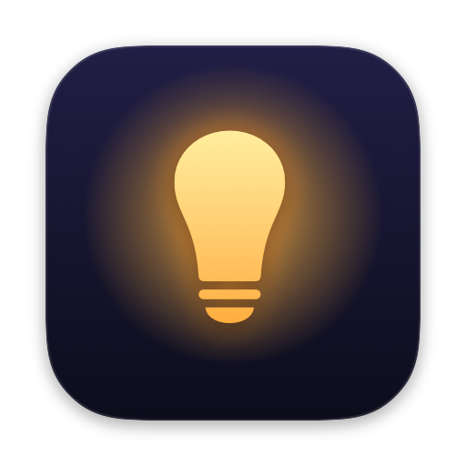
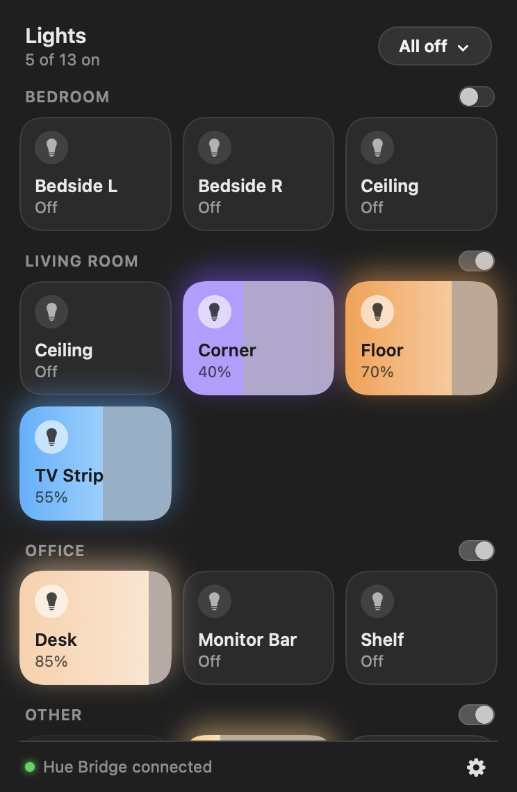
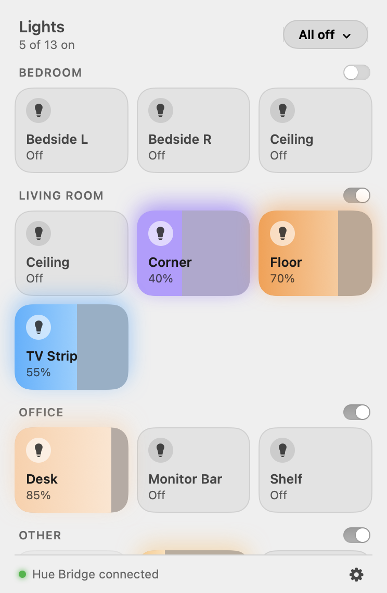
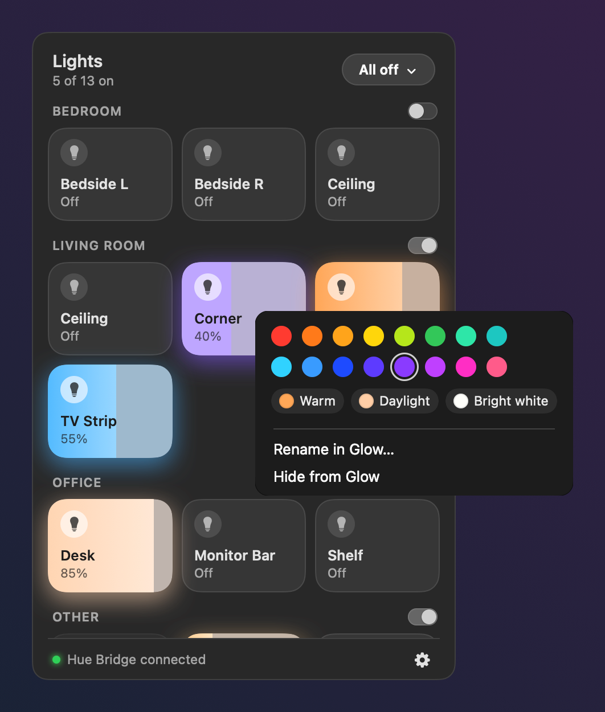

<p align="center"></p>

<h1 align="center">Glow</h1>
<p align="center"><b>Your Philips Hue lamps, one click away, right in the Mac menu bar.</b><br>
You don't need Siri, Alexa or your phone.</p>

<p align="center">
  <a href="https://github.com/merbil/glow/releases/latest"><b>Download for Mac</b></a> ·
  <a href="https://merterbil.com/glow/">Website</a> ·
  <a href="RELEASE_NOTES.md">Release notes</a> ·
  <a href="https://buymeacoffee.com/merbil">Buy me a coffee</a>
</p>

<p align="center">
  
  &nbsp;
  
</p>

## What it does

- **See every lamp** grouped by your Hue rooms, as tiles that glow in each lamp's real color.
- **Click** a tile to switch a lamp on or off, or **drag sideways** to dim it.
- **Right-click** for colors and whites (Glow only offers what that lamp supports).
- **Room switches** turn a whole room on or off.
- **All off** turns everything off now, or in 5, 15, 30 or 60 minutes. The timer runs on the bridge, so it still works while your Mac sleeps.
- **Lamps & Rooms** in Settings lets you drag rooms and lamps into your desired order and hide the ones you never interact with. It only changes Glow, so your Hue setup isn't touched.
- Changes from the Hue app, wall switches and voice assistants **show up live**.
- Works in **dark and light mode**, with keyboard and VoiceOver support.

<p align="center">
  
</p>

## Install

**You need:**
- macOS 14 (Sonoma) or later
- a Philips Hue **Bridge** on the **same network** as your Mac (Bluetooth-only bulbs aren't supported)

**Steps:**
1. Download **Glow-x.y.z.dmg** from the [latest release](https://github.com/merbil/glow/releases/latest). Open it and drag **Glow** onto **Applications**.
2. Open Glow. macOS says it **can't be opened**, because Glow isn't signed by an Apple-registered developer. Click **Done**.
3. Open **System Settings → Privacy & Security**, scroll down, click **Open Anyway** next to the message about Glow, and confirm. You only do this the first time.
4. Click the bulb in your menu bar and **Allow** Glow to find devices on your local network.
5. When Glow asks, **press the round button on your Hue Bridge**. You have 3 minutes. Your lamps then appear.

Already use Home Assistant? On the pairing screen you can paste its Hue key instead of pressing the button.

## Privacy & security

- Glow controls your lamps **directly through your Hue Bridge, on your home network**, with no account, cloud service or analytics involved.
  - Glow only goes online for two things. It asks Philips' bridge-finder (`discovery.meethue.com`) where your bridge is, during setup and whenever it can't find it any more. Also, it asks GitHub once a day for the latest version number, which you can turn off in Settings. It never sends your lamps, your usage or any account data.
- The bridge key is stored in a private file that only your user account can read (`~/Library/Application Support/Glow`).
- Glow checks that the bridge is a **genuine Philips Hue Bridge**:
  - its certificate must be signed by Philips' Hue root and issued to that bridge
  - Glow then pins that certificate
  - a pasted key is never sent to a device that hasn't passed this check
- Found a security issue? See [SECURITY.md](SECURITY.md).

## Build from source

You only need Apple's Command Line Tools (`xcode-select --install`). Xcode works too.

```sh
git clone https://github.com/merbil/glow && cd glow
swift build && .build/debug/Glow --demo        # run with sample lamps, no bridge needed
.build/debug/Glow --selftest                    # ~500 built-in checks, including a fake Hue Bridge
scripts/build-app.sh --install                  # build Glow.app and install it to /Applications
scripts/make-dmg.sh                             # build the installer DMG
```

`build-app.sh` signs with a local certificate named **"Glow Local Signing"** if you have one, so macOS keeps Glow's permissions across rebuilds. Without it, the build is signed ad hoc. See [CONTRIBUTING.md](CONTRIBUTING.md).

## Roadmap

- A Nest thermostat card (current and target temperature)

---

Glow is an independent project, **not affiliated with or endorsed by Signify or Philips Hue**. "Philips Hue" is a trademark of Signify.
Licensed under the [MIT License](LICENSE).
